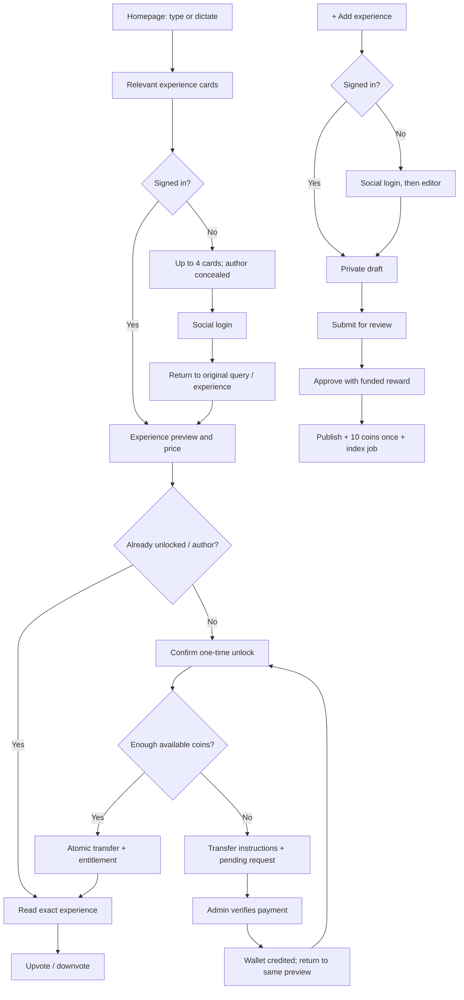

# Saariv experience marketplace design

**Status:** Draft for review; requested planning is complete when this design and the linked implementation roadmap are reviewed. This document does not authorize implementation, live payments, or deployment.

**Date:** 2026-10-21

**Repository baseline:** `origin/main` at `db656aee6c44ccfc56d6a55c29d3213dc4883a62` (`db656ae`). The remote has no `master` branch. Fetch confirmed that the checkout already contains the latest default branch. Local voice dictation edits are preserved.

**Implementation roadmap:** [Experience marketplace plan](../plans/2026-10-21-experience-marketplace.md)

## 1. Product decisions

### Confirmed with the user

| Area | Decision |
| --- | --- |
| Discovery | Homepage query box supports typing and voice dictation, with GPT assistance. |
| Signed in readers | Relevant experience cards show author ratings; qualified results are sorted primarily by author rating. |
| Guests | Show at most four cards with concealed author names. Opening a result or requesting more starts login. |
| Experience access | Pay once for permanent access to an experience. Reopening does not charge again. |
| Writing | Header has a plus action. Login returns the user to the experience editor. |
| Sign in | Google, LinkedIn, and Facebook. |
| Pricing | Author chooses the experience price in coins. |
| Insufficient funds | Recharge and return to the same experience and query. |
| Recharge | Manual transfer to the administrator's account with user identification; admin verifies before crediting coins. |
| Withdrawable funds | Purchased coins and earned coins are both eligible, including publication rewards. |
| Publication reward | Ten coins for a new approved experience, awarded once. Drafts and edits earn no additional reward. |
| Withdrawal rule | Minimum 100 coins, increments of 100 coins, leave at least 10 available coins at reservation time. |
| Withdrawal processing | Manual settlement with a visible request status; approximately one day is the intended service target. |

### Proposed defaults for this version

These are implementation choices to review, rather than additional user confirmations.

- Start with USD 1 = 100 coins, using integer cents and integer coins. Store the conversion on every request so later configuration changes cannot alter existing quotes.
- Transfer the entire experience price to the author; platform fee is zero initially.
- Authenticated search pages contain 12 cards; guests receive four with no usable next cursor.
- A first publication is reviewed before it is listed and before its ten coin reward is issued. Later revisions also require approval, with no additional reward.
- Approval requires sufficient funds in the platform reward treasury. An unfunded submission stays awaiting approval; it is not marked approved with an unpaid promised reward.
- Up/down votes are available to readers who unlocked the experience. Authors cannot buy or vote on their own work.
- Author rating starts neutral and uses a small Bayesian prior so one vote does not dominate rankings. The formula is described below.
- Top-up review target is approximately one hour; payout target is approximately 24 hours. These are estimates shown alongside actual status, not automatic credit or payout timers.
- The author confirms an identity-safe title and teaser for public cards; full story text remains behind access control.

## 2. Current code and the required change

The app is Flask with Jinja templates and vanilla JavaScript. `app.py` serves the marketing homepage, `/try` onboarding, and the avatar playground. The existing `knowledge/` package contains source ingestion, provider-neutral embeddings, SQLite source/keyword storage, Qdrant Local vectors, and a separate chat answer adapter.

The signed browser cookie in `knowledge/web.py` identifies a private prototype owner. It is not a Google/LinkedIn/Facebook account. The repository has no marketplace accounts, published experience records, unlock entitlements, ratings, coin ledger, or administrative payment queues.

Reuse:

- `static/js/story-dictation.js` for the homepage microphone and the existing story box.
- `knowledge/embeddings.py` for embeddings, with its independent provider configuration.
- `knowledge/chunking.py` and document readers for exact source spans.
- Existing taxonomy-only first prompt, narrative second prompt, and preservation of what the user actually said.
- Preserve whether the user asked about, planned, or actually completed an event; publication must not turn a question into a claimed personal experience.
- The current chat model/configuration for GPT query assistance and authorized answers.

Add a marketplace domain alongside this private knowledge system. Do not turn private avatar search into global search by dropping owner filters.

### Baseline gate

A fresh native run on 2026-10-21 executed 55 Python tests and returned eight failures and four errors. Important cases include source/profile changes and failed imports replacing prior searchable state; provider HTTP mocks also need updating for the current SSL call signature. Some expected wording is stale after the first-person requirement. Classify each failure before changing behavior.

The first implementation milestone restores the baseline with regression coverage. Keep raw evidence text separate from first-person display transformations so citation offsets continue to refer to the original source. See the foundation plan for the test log and exact scope.

## 3. Architecture choice

| Approach | Fit | Tradeoff |
| --- | --- | --- |
| **Extend Flask + PostgreSQL + Authlib + Qdrant** | Recommended; preserves onboarding, dictation, Python ingestion, templates, and provider adapters. | Requires explicit account, accounting, moderation, and operational code. |
| Managed authentication/database | Viable if the operator prefers a managed service. | Adds a service migration and still requires correct ledger and entitlement logic. |
| Full frontend/backend rewrite | Could support a different product direction later. | Expands this delivery without solving the main financial and privacy requirements. |

### Components

1. **Flask web app:** page rendering, social login callbacks, authenticated APIs, admin pages.
2. **PostgreSQL:** authoritative users, experiences/revisions, prices, entitlements, votes, ledger, payment requests, audit events, and outbox jobs.
3. **Private knowledge store:** existing owner-scoped sources remain private. Link a legacy owner to a signed in account only after proving possession of its signed browser cookie.
4. **Published search index:** separate collection containing only approved published revisions. Include experience/revision IDs and provenance. SQL visibility and access checks remain authoritative.
5. **Outbox worker:** indexes approved revisions, removes withdrawn listings, and records retry/error status. SQL commits before embedding/network work.
6. **Embedding adapter:** existing interchangeable compatible HTTP, Cohere, or Ollama support. Embedding model/profile identity is stored with each index version.
7. **Chat adapter:** existing chat provider/model. Query assistance can normalize the query and suggest taxonomy; it does not receive unpaid full stories.

Use SQLAlchemy 2, Alembic, psycopg 3, and Authlib. Select and pin supported versions during implementation. PostgreSQL row locks provide the transaction primitive for transfers and reservations; use a consistent account lock order. [PostgreSQL locking documentation](https://www.postgresql.org/docs/current/explicit-locking.html)

Use native development processes. No Docker or Testcontainers. Qdrant Local is acceptable for existing single-process development/tests; shared web/worker deployments use Qdrant server mode or a managed endpoint. Do not let multiple processes open the same local directory. Qdrant documents local mode for development and small workloads and provides native source development instructions. [Qdrant Local source](https://github.com/qdrant/qdrant-client/blob/master/qdrant_client/local/qdrant_local.py), [native development guide](https://github.com/qdrant/qdrant/blob/master/docs/DEVELOPMENT.md)

## 4. End-to-end user flows



### Homepage and read flow

- The homepage becomes a query-first screen with microphone, editable text, search action, wallet balance when signed in, and a top-right plus action.
- An optional GPT pass extracts search intent and taxonomy from the query. It uses the existing chat model and a bounded timeout. Invalid output, refusal, or provider outage falls back to searching the original query.
- Search approved published experiences using dense retrieval plus lexical retrieval. Deduplicate chunks to experiences and apply a calibrated relevance threshold.
- Sort only that relevant candidate set primarily by author rating; use relevance and a stable experience ID as tie breakers. A popular but unrelated experience must not displace a relevant one.
- Cards show title, approved teaser, taxonomy, coin price, author/rating when signed in, and an unlocked badge when applicable. They do not contain the full story in HTML, hidden DOM, JSON, structured metadata, or download links.
- Guest APIs enforce the four-card limit regardless of requested parameters. Guest payloads omit real author name, avatar, author ID, and author-profile URLs. A blurred placeholder provides the visual design without delivering the concealed identity.
- Title/teaser approval includes checking accidental identity disclosure. Deliberately public content can still identify an author; concealment is not an anonymity guarantee.
- Clicking a guest card or “See more” creates a server-side resume intent and starts login. After login, restore the query and selected experience.
- Signed in readers see a price preview. Unlocked users and the author can read immediately. Everyone else sees a clear unlock button.
- Unlocking is an authenticated, CSRF-protected POST with a current quote and an idempotency key. GET requests, login callbacks, polling, and payment approval never debit coins.
- If balance is insufficient, store the selected query/experience and offer recharge. After admin approval, return to the same preview and require the unlock action. Refresh the quote if the author changed the price.
- The exact author story is the primary purchased result. Any future GPT answer over paid material must check entitlements first and retain citations; it cannot bypass the paywall through search or the existing agent endpoint.

### Writing and approval

- The plus action routes to the editor; authentication preserves that destination.
- Reuse current import/story dictation inputs to prepare a private draft. Existing private files are never automatically listed or made searchable by other users.
- The author reviews title, teaser, taxonomy, story, provenance, and a positive integer coin price, then submits an immutable revision for review.
- First approval checks ownership, duplicates, basic quality, identity-safe teaser, price, and reward funds. One SQL transaction publishes the revision, awards ten coins, records the reward grant/audit event, and enqueues indexing.
- A pending embedding job does not undo a valid financial transaction. The detail is available to its author while discovery shows indexing status; failed jobs retry and are visible to admins.
- Later revisions require approval. The previous approved revision stays live until replacement. Revisions and edits do not earn another reward.
- Unpublishing prevents new discovery and purchases. Existing entitlements retain the purchased snapshot and receive later approved revisions while the experience remains available.
- Content removed for safety or ownership disputes requires a separate refund/removal policy before launch; do not silently destroy the purchase record.

### Wallet, recharge, and withdrawal

- Wallet shows available coins, reserved coins, withdrawable amount, transaction history, and pending requests.
- Add coins: choose amount, receive an immutable quote and administrator account details, transfer externally using a memo containing both user ID and request ID, then mark “I transferred.”
- The pending record exists before transfer instructions are displayed. User claims/screenshots do not create coins.
- Admin verifies the actual incoming transfer reference, currency, amount, and memo. Approval credits the wallet once and stores the unique external reference. Mismatches and late payments go to reconciliation.
- Wallet status polling shows credited/rejected/reconciliation states. It offers a link back to the exact experience; no silent purchase occurs.
- Withdraw: validate the confirmed rule, reserve coins immediately, show request status, and let the admin process the actual payout.
- A completed external payout consumes the reservation. A rejection or eligible cancellation releases it exactly once.
- An uncertain external transfer stays in processing/reconciliation. Do not retry the bank transfer just because an HTTP request timed out.

## 5. Identity and authorization

- Identity key is `(provider, subject)`, never email. Store email as optional profile/contact data.
- Google and LinkedIn use OpenID Connect; Facebook uses its supported login flow. Authlib supplies the Flask OAuth/OIDC integration. [Authlib Flask documentation](https://docs.authlib.org/en/latest/oauth2/client/web/flask.html)
- Validate OAuth state and OIDC nonce, signature, issuer, audience, and expiry. Use PKCE where supported. Register exact callbacks for each environment.
- LinkedIn requires enabling its OIDC sign-in product, and email fields can be absent. A successful social login is not an identity-verification badge. [LinkedIn sign-in documentation](https://learn.microsoft.com/en-us/linkedin/consumer/integrations/self-serve/sign-in-with-linkedin-v2)
- Account linking is an explicit authenticated action proving control of both identities. Matching email addresses alone do not merge wallets.
- Store server-side sessions; rotate session IDs on sign-in, revoke on sign-out, use Secure/HttpOnly/SameSite cookies in production. Apply CSRF to all state-changing browser requests and explicit CORS/origin rules.
- Resume intents are opaque, server-owned, bound to session/user, expire after a configurable period, and contain only internal destinations. Never accept arbitrary external `next` URLs.
- Keep query/story data out of OAuth authorization URLs. If an intent expires, show a safe return page rather than losing coins or silently selecting a different result.
- Roles are explicit. The same account can read and write; administrative permissions require a controlled role grant and audit event.
- Existing owner-scoped agent tokens continue to access only their private corpus. Marketplace agent access, if later added, must be account-bound, entitlement-aware, and unable to buy without explicit user authorization.
- Claiming legacy browser data requires the signed owner cookie and a one-time ownership link. An arbitrary owner ID, email, or profile path from the client is insufficient.
- Real social login must be tested in a supported system browser. Google prohibits directing OAuth requests to developer-controlled embedded user agents; the in-app browser is sufficient for ordinary page testing but not the only OAuth acceptance environment. [Google OAuth policies](https://developers.google.com/identity/protocols/oauth2/policies)
- The official Meta manual-flow page returned HTTP 429 during this planning review. Verify current Facebook setup, scopes, callback constraints, and Graph API version from Meta's official documentation/console during implementation; do not copy a deprecated example.

## 6. Data ownership and tables

Use UUID identifiers, UTC timestamps, foreign keys, explicit status enums, and migrations. All user-owned reads are scoped to the authenticated principal. SQL stores authoritative content; the vector index is a rebuildable derivative.

| Domain | Records and important constraints |
| --- | --- |
| Accounts | `users`, `oauth_identities` unique(provider, subject), `server_sessions`, `resume_intents`, `private_avatar_owners` unique(owner_id), `audit_events`. |
| Experiences | `experiences` with author/status/current approved revision; immutable `experience_revisions` with body, approved teaser, source references, normalized hash, taxonomy, price; `publication_jobs` outbox with revision/profile/generation. |
| Search | PostgreSQL text search over approved content, published chunk metadata, optional short-lived `search_sessions` that retain query/selection for return navigation. |
| Purchases | `purchase_quotes` with reader, experience, revision, price, expiry; `entitlements` unique(reader_id, experience_id), original purchased revision and transaction ID. |
| Wallet | `wallet_accounts`, `ledger_transactions`, `ledger_entries`, wallet balance projection; unique(kind, operation reference) and scoped idempotency keys with request hashes. |
| Manual funds | `recharge_requests`, `withdrawal_requests`, `payout_destinations`, `fiat_movements` with unique verified incoming/outgoing references, immutable quoted rate/currency, status history. |
| Reputation | `votes` unique(reader_id, experience_id), `author_rating_summary`, `publication_reward_grants` unique(experience_id) and unique(author_id, normalized_content_hash), `approved_content_fingerprints` retaining all approved revision hashes and their canonical experience, treasury funding records. |

A request can have multiple status events, but each financial effect has one stable operation reference. Ledger transactions reference purchases/rewards/top-ups/payouts explicitly. Never infer a balance from mutable UI state or author-provided prices.

## 7. Financial rules and invariants

### Ledger model

All amounts are integers. Every ledger transaction contains signed coin entries summing to zero. Each user has AVAILABLE and RESERVED accounts; provenance remains in transaction type, so purchased/earned/reward coins can share the same available balance.

| Event | Debit / negative entry | Credit / positive entry |
| --- | --- | --- |
| Approved recharge of 100 | Platform recharge clearing: -100 | Reader AVAILABLE: +100 |
| Unlock priced 20 | Reader AVAILABLE: -20 | Author AVAILABLE: +20 |
| Approved publication | Prefunded reward treasury: -10 | Author AVAILABLE: +10 |
| Reserve withdrawal of 100 | User AVAILABLE: -100 | User RESERVED: +100 |
| Settle payout of 100 | User RESERVED: -100 | Platform payout clearing: +100 |
| Reject/cancel reservation | User RESERVED: -100 | User AVAILABLE: +100 |

Clearing accounts may carry signed balances and reconcile against verified fiat movements. User accounts and reward treasury cannot become negative. Funding the reward treasury requires an operator-recorded, verified budget contribution, offset against a funding clearing account. Corrections use compensating transactions, not updates/deletions to ledger entries.

USD 1 = 100 coins implies a ten coin publication reward costs the platform USD 0.10 before fees under the proposed conversion. Because rewards are withdrawable, the treasury must be deliberately funded and reconciled. Manual approval and duplicate controls constrain spending; no draft, edit, or arbitrary client callback issues rewards.

### Atomicity and idempotency

- Lock affected accounts in stable identifier order, validate available funds, post balanced entries, update projections, create the entitlement/request state/audit, then commit together.
- Unlock operation has a permanent unique reader/experience entitlement. Repeated or concurrent attempts return the existing receipt without another debit.
- Idempotency keys are scoped to actor and operation; replay with a different payload is a conflict. Store a canonical request hash and stable result reference.
- Concurrency must not overspend, double-approve a transfer, double-reserve a withdrawal, or double-pay a publication reward.
- Network calls, GPT, embeddings, and actual bank actions happen outside locked SQL transactions.
- A price quote expires after a configurable short interval. Stale price/revision quotes return a refresh action without moving coins.
- The author reads for free. Self-purchase and self-vote are rejected.
- No money mutation is exposed through GET. Account identity, balance, approval, and verified transfer status come from the server.
- Enforce account invariants in PostgreSQL, test transaction rollback, and run reconciliation of ledger sums, wallet projections, reservations, grants, and external movement references.

### Withdrawal formula

```text
withdrawable_coins = floor(max(available_coins - 10, 0) / 100) * 100
requested_coins >= 100
requested_coins % 100 == 0
requested_coins <= withdrawable_coins
```

Examples: 100 available permits no withdrawal; 110 permits 100; 310 permits 300. Pending withdrawals have already moved into RESERVED and cannot be spent or reserved again.

“Keep ten” is checked when creating the reservation. It is not a permanent ten coin minimum for all purchases: the user can later spend remaining available coins, and an already reserved payout can still settle.

## 8. State machines

| Object | Allowed lifecycle | Financial effect |
| --- | --- | --- |
| Revision | draft → submitted → approved / rejected; submitted → withdrawn | First funded approval pays ten once. Later revisions pay zero. |
| Experience | draft → published → archived; moderation hold is separate | Archiving stops new sales, preserves entitlement/ledger evidence. |
| Index job | pending → running → complete / retry / failed | None. SQL revision visibility governs all returned hits. |
| Recharge | pending_payment → pending_review → credited / rejected / reconciliation | Only verified approval credits once. Late transfer to closed request needs reconciliation. |
| Withdrawal | pending_review → processing → settled; pending_review → rejected / cancelled; processing → reconciliation | Request reserves, settlement consumes reserved, rejection/cancellation releases once. |
| Entitlement | created after successful purchase; permanent in normal product flow | No repeated debit. Exceptional removal/refund must retain audit history. |
| Vote | absent ↔ +1 / -1 | None. Changing a vote recomputes the author's aggregate. |

Use explicit transition checks and optimistic state versions or row locks. A stale administrator page cannot repeat a previous transition. A failed/ambiguous external payout cannot be marked rejected merely to free funds.

## 9. Retrieval, rankings, and content protection

### Indexing

- New approved revision commits an outbox job. Worker reads SQL, embeds exact approved narrative chunks, records provider/model/dimensions/preprocessing profile, and upserts the published collection.
- New profile builds a separate generation. Swap only when a full rebuild succeeds; retain source documents and the prior usable generation on failure.
- SQL lookup verifies every hit is published, matches the approved revision/generation, and is visible to the caller. Index deletion lag cannot expose archived or unapproved material.
- Dense and PostgreSQL lexical candidates are combined with reciprocal rank fusion; only relevant candidates reach the rating sort.
- Embedding failure can yield a clearly labeled lexical search mode. Do not erase existing vectors or claim hybrid success when no usable dense results exist.
- A vector/lexical hit contains internal source text only in the retrieval service. The public card serializer is an allowlist; raw source fields never escape to guests or locked readers.
- Body access uses the entitlement service even if the caller guesses IDs or invokes the old knowledge endpoints.
- Embeddings stay replaceable. A different answer model can use authorized text/citations without sharing the embedding model; switching embedding space requires reindexing.

### Author rating

Proposed ranking score:

```text
author_score = (valid_upvotes + 2) / (valid_upvotes + valid_downvotes + 4)
```

Aggregate valid votes across the author's approved experiences, including archived items so hiding an unpopular listing does not erase its history. Show the actual helpful percentage/count and a “new author” state when no real votes exist; do not display the prior as real reviews.

Only a reader with an entitlement can set one vote per experience to +1, -1, or 0 (remove). Vote changes are idempotent; counts update transactionally and cannot go negative. Moderated fraudulent votes require an audited correction. No coins are awarded for voting in this version.

For each query: relevance threshold first, then author score descending, then query relevance descending, then stable experience ID. Persist a short-lived result snapshot or stable cursor ordering so votes arriving between pages do not duplicate/skip entries.

## 10. Administrative interface

Provide protected queues for:

- Experience submissions and later revisions, with reward eligibility, duplicate flags, treasury balance, and approve/reject reasons.
- Incoming transfers, with expected amount/memo, user claim, verified bank reference, and reconciliation status.
- Withdrawal requests, with available/reserved context, redacted payout destination, status history, start/settle/reject actions.
- Reward treasury funding and spending history.
- Indexing failures and ledger reconciliation exceptions.

Every decision records actor, UTC time, before/after status, request version, reason, and external reference where applicable. No generic editable wallet balance field. Sensitive payment details stay out of logs, public search, and ordinary author profiles.

## 11. Delivery and verification

Deliver in stages: restore baseline; accounts and shared schema; private drafts and search; ledger and purchases; manual recharge/payout; funded approval rewards, voting, and release verification. Intermediate builds can exercise drafts/submissions in test mode but cannot list real paid content until approval and money invariants are complete.

Important release gates:

1. **Privacy:** guest/locked response inspection proves zero full-story leakage and zero concealed author identifiers; guessed IDs, stale index hits, agent routes, and other users' private drafts are denied.
2. **Correctness:** failed imports/rebuilds preserve usable prior sources; all provider profiles stay distinct; old first-person presentation changes do not invalidate raw citations.
3. **Money:** native PostgreSQL concurrency tests prove one charge under parallel unlocks, no overspend across distinct purchases, one reward/top-up per operation, and reserved funds cannot be spent.
4. **Navigation:** guest/login and insufficient-funds/recharge restore the exact selected experience and query, without auto-charging.
5. **OAuth:** mocked error tests plus actual Google/LinkedIn/Facebook acceptance in supported browsers and configured environments.
6. **Retrieval:** a held-out set of at least 50 realistic queries with relevance labels, expected author IDs, and unknown queries. Report Recall@k, MRR, nDCG, false-positive/no-answer behavior, and rating order separately.
7. **Operations:** migration backup/restore rehearsal, outbox retry recovery, ledger reconciliation, and admin audit checks.

Proposed performance target: search p95 under two seconds without optional GPT preprocessing; measure GPT and embedding latency/cost separately. Treat this as a target, not a measured result. Track approval age, payout age, indexing lag, fallback rate, search relevance, and zero ledger reconciliation variance. Click/unlock conversion is a product metric, not proof of retrieval accuracy.

Development and CI use synthetic accounts/content and a dedicated native PostgreSQL test database. Simulated transfer references exist only in test fixtures; development never performs real bank transfers. Do not mark OAuth or payment smoke tests passed when required external configuration is unavailable.

## 12. Launch inputs to obtain

Implementation can proceed on local contracts and deterministic tests before these are ready. Real login/payment launch requires:

- Registered Google, LinkedIn, and Facebook applications, approved redirect URLs, and secrets supplied through environment configuration.
- Confirmed operating currency and conversion, administrator receiving account/payment instructions, supported payout method, and a funded publication reward budget.
- Administrator identities and role grants.
- Final terms for refunds, disputed or removed content, duplicate submissions, and payment/payout timing.
- Production hostname, HTTPS/session secrets, PostgreSQL backup destination, and Qdrant endpoint/access settings.

No credentials, real account details, or private stories belong in this plan or Git history.
